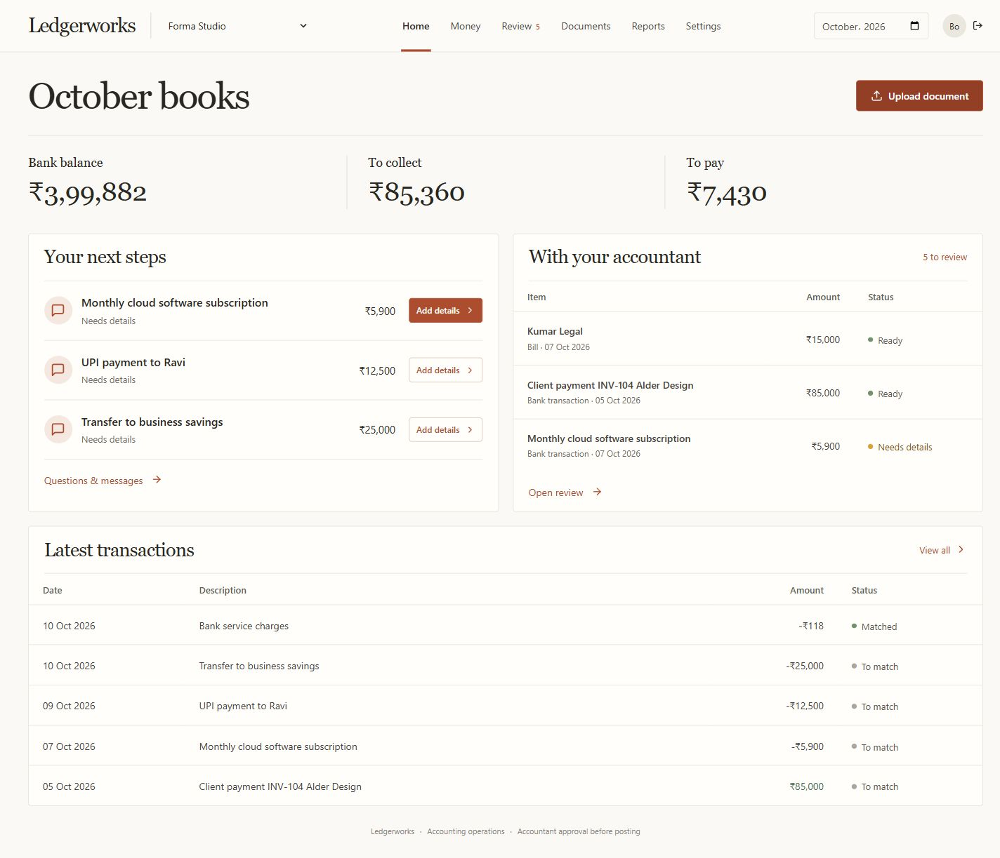
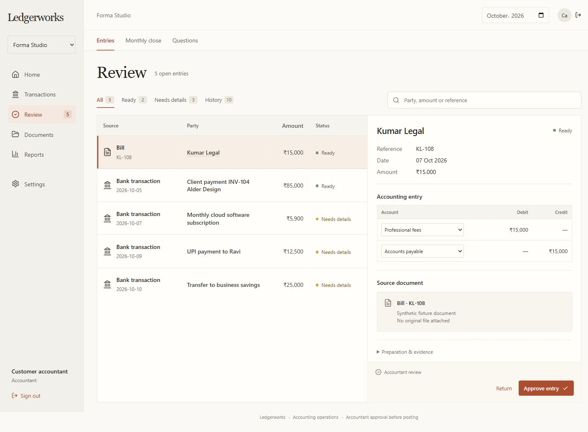

# Ledgerworks accounting platform

A standalone accounting workspace for Indian businesses, service operators and the customer's existing accountant. The separate Chausar integration design and standalone blueprint in the parent workspace are preserved.

The current local app runs at http://127.0.0.1:4310 using real PostgreSQL, persistent local Temporal and a separate compiled accounting worker. Real local model inference and automatic OCR have been exercised. The three original companies and added qualification records are synthetic.

The frontend uses the approved B styling and owner home, with C's accountant review layout. Owners see balances, next steps and transactions; accountants land in a source-led review desk. All 20 views remain available through grouped navigation. See [the redesign and verification notes](docs/frontend-redesign.md).





The repository includes source, deployment configuration, tests, original design options and current UI previews. Runtime databases, uploaded documents, credentials, model caches and generated packages are excluded. Build the frontend and backend after installing dependencies; compiled output is not stored in Git.

## Run locally

Requires Node.js 22.22.3 or later. For SQLite development with explicit fixture connectors:

```powershell
npm ci
npm run build
npm start
```

Development users are operator, accountant and owner, each with password demo. Production disables these shortcuts and requires configured identities. Demo Tally and Zoho companies use explicitly labelled fixture adapters. Fixture posting is not evidence of live vendor integration.

For the persistent PostgreSQL/Temporal qualification stack already provisioned in this checkout:

```powershell
node scripts/local-services.mjs
```

Its data, downloaded runtimes, private connection configuration and logs are under data/runtime and excluded from the ZIP. Stop with Ctrl+C. On a fresh machine first run the PostgreSQL and Temporal verification scripts to provision the official portable runtimes. Production uses [the portable deployment guide](docs/deployment.md) and deploy/compose.yml.

## Product capabilities

| Area | Behavior |
| --- | --- |
| Books and review | Exact money, balanced journals, immutable entries/approvals, company ACLs, explicit questions, source-bound revisions, accountant approval and source-effect verification |
| Accounting workflows | Bills to books, bank reconciliation, month-end, schedules and reviewed reversals, durable runs and standalone approval workflows |
| Payables/receivables | Native bills/invoices, full and partial settlements, source identities/allocations and dated native/Tally ageing |
| Zoho | OAuth refresh/cache, pagination, chart/general ledger/contacts/bills/invoices/bank sync, semantic document/payment/expense/journal writes, statement categorization and per-account GL readback |
| Tally | Scoped Windows gateway, group/ledger/voucher/opening/closing balance sync, party controls and bill allocations, Purchase/Sales/Payment/Receipt/Journal creation and voucher readback |
| Source corrections | New immutable reversals/effects for changed or removed source transactions; signed periods require reasoned reopening |
| Documents | Original bytes and fingerprints, local image/scanned-PDF OCR, PDF/text extraction, retries and reviewed document-to-bill intake |
| AI | Real local ONNX category proposals; optional bounded Pi/OpenAI proposal agent; uncertainty questions and accountant approval |
| Statutory delivery | GSTR-1/GSTR-3B/TDS/e-invoice/e-way-bill preparation, schema versions, source-bound approval, manual export, configurable provider gateway, receipts and unknown-outcome reconciliation |
| Reports | TB/P&L/BS, period P&L and cumulative BS, monthly budgets, AP/AR ageing, working consolidation and evidence/workpaper exports |
| Service delivery | Owner intake, operator preparation, accountant approval, persistent customer questions/replies/resolution |
| Security/operations | Scrypt identities, optional TOTP, revocation, login cap, CSRF, secure production cookies/CSP, encrypted company backup/restore, readiness, sync job visibility, Docker stack and CI |

Preparation never initiates a money transfer. AI proposes categories; financial amounts, posting admission and validation are application code. The accountant approves the exact revision. Source receipts are persisted before follow-up readback. An unknown remote outcome cannot be blindly redispatched. Connected period sign-off is a workspace control; it does not remotely lock Tally/Zoho books.

GST/TDS values and eligibility remain accountant-configured. Generated return workpapers require completion under the registered official/provider schema. Manual export does not mean filed. The configured provider must implement the [normalized filing contract](docs/provider-contract.md); selecting an arbitrary provider URL is insufficient. No source organization or government/provider account has been authorized here.

Schedules are reviewed linear allocations, not full payroll/lease/stock-option/inventory valuation engines. Native books use INR. Historical Zoho ageing uses current source balances. Full statutory reporting, specialized valuation and source-specific credits/refunds are qualification/extension areas documented in [the qualification register](docs/qualification.md).

## Verification and handoff

```powershell
npm run check
npm audit --omit=dev
node --import tsx scripts/verify-ocr.ts
node --import tsx scripts/verify-model.ts
node --import tsx scripts/verify-postgres.ts
node --import tsx scripts/verify-temporal.ts
node scripts/verify-live-stack.mjs
node scripts/verify-model-workflow.mjs
node scripts/package.mjs
```

Verification scripts create synthetic records and may download official runtimes/weights. The live-stack scripts target the local development app and demo identities. The result log is [docs/verification.md](docs/verification.md). There are 36 passing automated tests and no known production dependency vulnerabilities at the last audit. Real OCR, model, PostgreSQL, Temporal restart, and a complete HTTP product flow passed.

The [initial GitHub CI run](https://github.com/moheekn-tech/ledgerworks-accounting-platform/actions/runs/38599142939) passed build, tests, dependency audit and Docker image build on 14 October 2026. Deployment to your server and production container startup remain unexecuted. Your Tally machine/company, Zoho OAuth organization, filing provider/DSC/FVU and server/domain access are needed for external acceptance. [Deployment instructions](docs/deployment.md) explain activation and recovery.

The distribution ZIP includes source, compiled backend/frontend, schemas, tests and deployment files. Runtime data, credentials, model weights and node_modules are excluded. This is an owned reconstruction informed by public vendor contracts; Billow's private implementation is not known.
