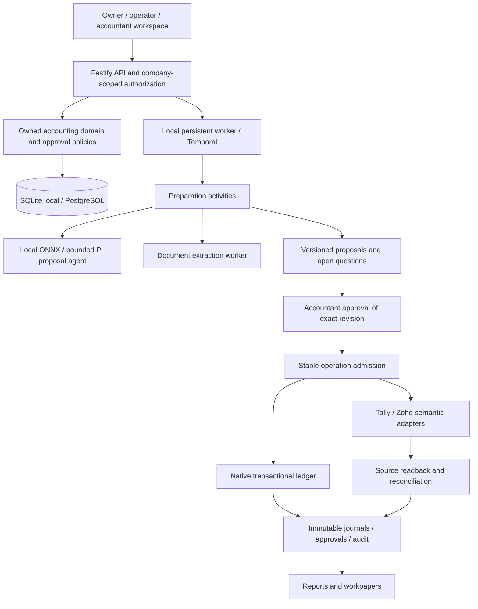

# Architecture

`server/domain.ts` owns exact-money admission, dates and roles. `server/engine.ts` owns the proposal and operation lifecycle. `server/store.ts` owns transactions, immutable accounting facts and optimistic revisions. Connector behavior stays in `server/adapters.ts`; agent preparation stays in `server/agent-runner.ts`. React presents these owned operations and their evidence.

The AI proposes an allowed account and questions. It does not choose financial amounts, approve entries or execute accounting writes. A business operation identity persists independently of worker restarts. An uncertain remote outcome requires source evidence and readback; repeat dispatch is denied.

The native ledger is authoritative for native companies. For connected companies, real external-system authority requires complete, qualified source coverage. Complete balanced snapshots permit workspace sign-off; this does not lock the source ledger. Failed synchronization marks the snapshot stale. Fixture adapters are a separate mode throughout the UI and receipt history.

The same owned domain and API can later serve Chausar integration. The actual Chausar repository has not been provided, so no repository integration is claimed.
